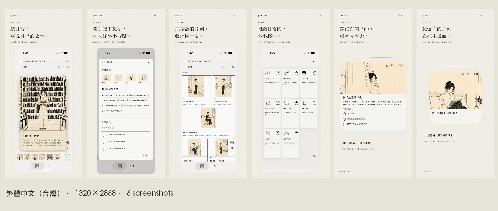

# YOUR DAY — App Store 6.9인치 스크린샷

2026-10-26 · 언어별 6장, 총 24장

- 규격: 1320 × 2868px, 세로 PNG, RGB/sRGB, 알파 채널 없음
- `kr/`: 한국어, App Store Connect 한국어
- `ja/`: 일본어, App Store Connect 일본어
- `us/`: 미국 영어, App Store Connect 영어(미국)
- `index.html`: 언어를 바꾸며 보는 미리보기. 브라우저에서 열면 됩니다.
- `previews/`: 언어별 전체 구성 JPG. 업로드 파일에 포함하지 마세요.

각 언어 폴더의 PNG 6장을 파일명 순서로 업로드하세요.

| 순서 | 파일 | 내용 |
|---|---|---|
| 01 | 01-your-scenes.png | 나의 장면 |
| 02 | 02-notes-and-todos.png | 메모와 할 일 |
| 03 | 03-day-overview.png | 하루 모아보기 |
| 04 | 04-mate-cards.png | 메이트 카드 |
| 05 | 05-large-widget.png | 큰 위젯 |
| 06 | 06-small-widget.png | 작은 위젯 |

## 제작 내용

사용자가 첨부한 실제 화면과 프로젝트의 원본 일러스트로 구성했습니다. 한국어 앱 화면은 원본을 사용했습니다. 일본어·영어 앱 화면은 원본의 구조를 유지하며 UI 및 샘플 내용을 현지화한 합성 이미지로, 기기에서 새로 캡처한 파일은 아닙니다. 샘플 문구는 프로젝트의 기존 일본어·영어 목업 문구를 사용했고, 일부 메모는 읽기 편하게 줄였습니다. 작은 원본 캡처의 확대 손실을 줄이기 위해 위젯은 프로젝트의 고해상도 그림과 원본 화면의 배치를 바탕으로 재구성했습니다.

`source/`에는 원본 캡처, 현지화된 화면 및 재생성 가능한 레이아웃 코드가 있습니다. 앱 코드는 바꾸지 않았습니다.

규격 참고: [Apple — Screenshot specifications](https://developer.apple.com/help/app-store-connect/reference/app-information/screenshot-specifications/)

## 전체 구성

### KR

### JA

### US

## 대만 번체 중국어 추가 · 2026-10-27

- `zh-TW/`: 번체 중국어(대만), PNG 6장. App Store Connect에서는 **중국어(번체), zh-Hant**를 선택하세요.
- `zh-TW.zip`: 번체 업로드 파일 6장만 포함합니다. 기존 한·영·일 ZIP은 보존했습니다.
- 대만식 표현(主畫面, 小工具, 待辦)과 번체 글꼴을 사용했습니다. 홍보 문구, 화면 UI, 메모와 할 일 예시를 현지화했습니다.
- 기존 디자인과 원본 캡처를 바탕으로 제작한 현지화 합성 이미지이며, 새로 기기에서 캡처한 화면은 아닙니다. 앱 소스 코드는 변경하지 않았습니다.
- 재생성: `node source/build-zh-tw.cjs`. 두 기기 폴더를 나란히 두고 iPhone → iPad 순서로 실행합니다. macOS의 번체 글꼴을 사용하며 글꼴 파일은 배포하지 않습니다. 프로젝트 위치가 다르면 `POKIT_PROJECT_ROOT`를 지정하세요.

